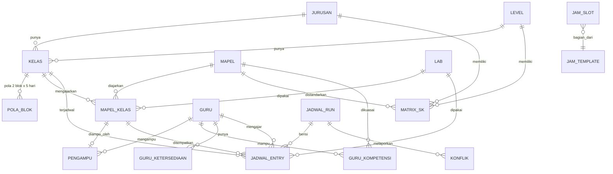

# DATABASE.md — Skema Data Penjadwal Blok SMK

Penyimpanan utama: **IndexedDB** via Dexie (offline-first). Skema ditulis dalam dua bentuk:
- Bagian 3: **DDL SQL portabel** (sumber kebenaran logis; juga siap dipakai bila nanti pindah ke SQLite/Postgres).
- Bagian 7: **skema Dexie** (implementasi nyata).

Konvensi: tabel `snake_case`, PK `id` (ULID string, dibuat di klien), kolom waktu ISO-8601 UTC.
Enum dan angka: `blok_no` in (1,2); `hari` 1=Senin ... 5=Jumat; `jp_ke` 1..N.

---

## 1. Diagram Relasi



## 2. Aturan Umum Integritas

1. **Soft-delete** untuk master (`aktif = 0`); hapus fisik hanya bila tak ada referensi, lewat fungsi `canDelete()` yang mengembalikan daftar pemakai.
2. **Transaksi**: operasi yang menyentuh > 1 tabel dibungkus satu transaksi Dexie (`rw`). Gagal = rollback seluruhnya.
3. **Validasi di dua lapis**: Zod saat masuk/keluar repository, constraint di DB (unik) sebagai jaring pengaman.
4. **Jadwal adalah turunan**: `jadwal_entry` tidak boleh menjadi satu-satunya tempat fakta penting. Target JP berasal dari `mapel_kelas`; pola hari dari `pola_blok`.
5. **Snapshot konfigurasi**: tiap `jadwal_run` menyimpan salinan JSON konfigurasi (setting, bobot, hash data) agar hasil dapat dijelaskan setelah data berubah.
6. **Kolom `is_assumed`** pada data yang diisi default (pola blok, template jam) agar UI menampilkan penanda asumsi.

---

## 3. DDL SQL (Logis)

```sql
-- ===== META & SETTING =====
CREATE TABLE meta (
  key        TEXT PRIMARY KEY,           -- 'schema_version','app_id','created_at'
  value      TEXT NOT NULL
);

CREATE TABLE setting (
  key        TEXT PRIMARY KEY,           -- lihat bagian 4
  value_json TEXT NOT NULL,
  updated_at TEXT NOT NULL
);

-- ===== REFERENSI =====
CREATE TABLE level (
  id      TEXT PRIMARY KEY,
  kode    TEXT NOT NULL UNIQUE,          -- 'X','XI','XII'
  urutan  INTEGER NOT NULL
);

CREATE TABLE jurusan (
  id      TEXT PRIMARY KEY,
  kode    TEXT NOT NULL UNIQUE,          -- 'AK','TKR','TKJ','PSPT','KUL','DPB','APAT','LAS'
  nama    TEXT NOT NULL,
  aktif   INTEGER NOT NULL DEFAULT 1 CHECK (aktif IN (0,1))
);

CREATE TABLE kelas (
  id          TEXT PRIMARY KEY,
  level_id    TEXT NOT NULL REFERENCES level(id),
  jurusan_id  TEXT NOT NULL REFERENCES jurusan(id),
  rombel_no   INTEGER NOT NULL CHECK (rombel_no >= 1),
  nama        TEXT NOT NULL,             -- 'X PSPT 1'
  wali_guru_id TEXT REFERENCES guru(id),
  aktif       INTEGER NOT NULL DEFAULT 1,
  UNIQUE (level_id, jurusan_id, rombel_no)
);

CREATE TABLE pola_blok (
  id          TEXT PRIMARY KEY,
  kelas_id    TEXT NOT NULL REFERENCES kelas(id) ON DELETE CASCADE,
  blok_no     INTEGER NOT NULL CHECK (blok_no IN (1,2)),
  hari        INTEGER NOT NULL CHECK (hari BETWEEN 1 AND 5),
  jenis       TEXT NOT NULL CHECK (jenis IN ('PRODUKTIF','REGULER')),
  is_assumed  INTEGER NOT NULL DEFAULT 0,
  UNIQUE (kelas_id, blok_no, hari)       -- 2 x 5 = 10 baris per kelas
);

-- ===== MAPEL =====
CREATE TABLE lab (
  id      TEXT PRIMARY KEY,
  kode    TEXT NOT NULL UNIQUE,
  nama    TEXT NOT NULL,
  kapasitas_paralel INTEGER NOT NULL DEFAULT 1 CHECK (kapasitas_paralel >= 1),
  aktif   INTEGER NOT NULL DEFAULT 1
);

CREATE TABLE mapel (
  id            TEXT PRIMARY KEY,
  kode          TEXT NOT NULL UNIQUE,
  nama          TEXT NOT NULL,
  kelompok      TEXT NOT NULL,           -- 'UMUM','C1','C2','C3','MULOK','LAINNYA'
  jenis         TEXT NOT NULL CHECK (jenis IN ('PRODUKTIF','REGULER')),
  is_berat      INTEGER NOT NULL DEFAULT 0,
  is_pjok       INTEGER NOT NULL DEFAULT 0,
  butuh_lab     INTEGER NOT NULL DEFAULT 0,
  lab_default_id TEXT REFERENCES lab(id),
  maks_jp_sesi  INTEGER CHECK (maks_jp_sesi BETWEEN 1 AND 8),
  aktif         INTEGER NOT NULL DEFAULT 1
);

-- Struktur kurikulum: JP standar per (jurusan, level, mapel)
CREATE TABLE matrix_sk (
  id          TEXT PRIMARY KEY,
  jurusan_id  TEXT NOT NULL REFERENCES jurusan(id),
  level_id    TEXT NOT NULL REFERENCES level(id),
  mapel_id    TEXT NOT NULL REFERENCES mapel(id),
  jp_blok1    INTEGER NOT NULL DEFAULT 0 CHECK (jp_blok1 BETWEEN 0 AND 20),
  jp_blok2    INTEGER NOT NULL DEFAULT 0 CHECK (jp_blok2 BETWEEN 0 AND 20),
  UNIQUE (jurusan_id, level_id, mapel_id)
);

-- Mapel yang benar-benar diajar di sebuah kelas (turunan matrix + override)
CREATE TABLE mapel_kelas (
  id           TEXT PRIMARY KEY,
  kelas_id     TEXT NOT NULL REFERENCES kelas(id) ON DELETE CASCADE,
  mapel_id     TEXT NOT NULL REFERENCES mapel(id),
  jp_blok1     INTEGER NOT NULL CHECK (jp_blok1 BETWEEN 0 AND 20),
  jp_blok2     INTEGER NOT NULL CHECK (jp_blok2 BETWEEN 0 AND 20),
  pola_sesi1   TEXT,                     -- '3+3'; NULL = otomatis
  pola_sesi2   TEXT,
  lab_id       TEXT REFERENCES lab(id),
  sumber       TEXT NOT NULL DEFAULT 'SK' CHECK (sumber IN ('SK','OVERRIDE','KHUSUS')),
  aktif        INTEGER NOT NULL DEFAULT 1,
  UNIQUE (kelas_id, mapel_id)
);

-- ===== GURU =====
CREATE TABLE guru (
  id            TEXT PRIMARY KEY,
  kode          TEXT NOT NULL UNIQUE,    -- 'G07'
  nip_nik       TEXT,
  nama          TEXT NOT NULL,
  jp_min        INTEGER,                 -- NULL = ikut setting global
  jp_maks       INTEGER,
  maks_jp_hari  INTEGER,
  min_hari_bebas INTEGER,
  maks_gap      INTEGER,
  aktif         INTEGER NOT NULL DEFAULT 1
);

CREATE TABLE guru_kompetensi (
  guru_id  TEXT NOT NULL REFERENCES guru(id) ON DELETE CASCADE,
  mapel_id TEXT NOT NULL REFERENCES mapel(id),
  PRIMARY KEY (guru_id, mapel_id)
);

CREATE TABLE guru_ketersediaan (
  id        TEXT PRIMARY KEY,
  guru_id   TEXT NOT NULL REFERENCES guru(id) ON DELETE CASCADE,
  blok_no   INTEGER NOT NULL CHECK (blok_no IN (1,2)),
  hari      INTEGER NOT NULL CHECK (hari BETWEEN 1 AND 5),
  jp_ke     INTEGER NOT NULL CHECK (jp_ke >= 1),
  status    TEXT NOT NULL CHECK (status IN ('TIDAK_BISA','HINDARI')),  -- default = bisa (tidak disimpan)
  UNIQUE (guru_id, blok_no, hari, jp_ke)
);

CREATE TABLE pengampu (
  id             TEXT PRIMARY KEY,
  mapel_kelas_id TEXT NOT NULL UNIQUE REFERENCES mapel_kelas(id) ON DELETE CASCADE, -- 1 guru per mapel-kelas (v1)
  guru_id        TEXT NOT NULL REFERENCES guru(id)
);

-- ===== TEMPLATE JAM =====
CREATE TABLE jam_template (
  id        TEXT PRIMARY KEY,
  nama      TEXT NOT NULL,
  aktif     INTEGER NOT NULL DEFAULT 0,  -- hanya satu aktif
  is_assumed INTEGER NOT NULL DEFAULT 0
);

CREATE TABLE jam_slot (
  id           TEXT PRIMARY KEY,
  template_id  TEXT NOT NULL REFERENCES jam_template(id) ON DELETE CASCADE,
  hari         INTEGER NOT NULL CHECK (hari BETWEEN 1 AND 5),
  urutan       INTEGER NOT NULL,          -- urutan baris dalam hari
  tipe         TEXT NOT NULL CHECK (tipe IN ('JP','ISTIRAHAT')),
  jp_ke        INTEGER,                   -- hanya bila tipe='JP'
  mulai        TEXT NOT NULL,             -- 'HH:MM'
  selesai      TEXT NOT NULL,
  is_long_break INTEGER NOT NULL DEFAULT 0,
  UNIQUE (template_id, hari, urutan),
  CHECK ((tipe = 'JP' AND jp_ke IS NOT NULL) OR (tipe = 'ISTIRAHAT' AND jp_ke IS NULL)),
  CHECK (mulai < selesai)
);
-- UNIQUE (template_id, hari, jp_ke) berlaku untuk baris tipe 'JP' (indeks parsial / diperiksa di repository)

-- ===== JADWAL =====
CREATE TABLE jadwal_run (
  id          TEXT PRIMARY KEY,
  nama        TEXT NOT NULL,              -- 'Varian A'
  status      TEXT NOT NULL CHECK (status IN ('DRAFT','PERLU_VERIFIKASI','TERVERIFIKASI','FINAL')),
  seed        INTEGER NOT NULL,
  config_json TEXT NOT NULL,              -- snapshot setting + bobot + hash data input
  stats_json  TEXT,                       -- skor, waktu, jumlah sesi, unplaced
  created_at  TEXT NOT NULL,
  updated_at  TEXT NOT NULL
);

CREATE TABLE jadwal_entry (
  id             TEXT PRIMARY KEY,
  run_id         TEXT NOT NULL REFERENCES jadwal_run(id) ON DELETE CASCADE,
  blok_no        INTEGER NOT NULL CHECK (blok_no IN (1,2)),
  kelas_id       TEXT NOT NULL REFERENCES kelas(id),
  hari           INTEGER NOT NULL CHECK (hari BETWEEN 1 AND 5),
  jp_ke          INTEGER NOT NULL CHECK (jp_ke >= 1),
  mapel_kelas_id TEXT NOT NULL REFERENCES mapel_kelas(id),
  guru_id        TEXT NOT NULL REFERENCES guru(id),
  lab_id         TEXT REFERENCES lab(id),
  sesi_id        TEXT,                    -- mengelompokkan JP berurutan satu sesi
  is_locked      INTEGER NOT NULL DEFAULT 0,
  UNIQUE (run_id, blok_no, kelas_id, hari, jp_ke),      -- H2
  UNIQUE (run_id, blok_no, guru_id, hari, jp_ke)        -- R1
);
-- H3 (lab): UNIQUE (run_id, blok_no, lab_id, hari, jp_ke) WHERE lab_id IS NOT NULL
--           (kapasitas_paralel > 1 diperiksa di verifier, bukan constraint)

CREATE TABLE konflik (
  id         TEXT PRIMARY KEY,
  run_id     TEXT NOT NULL REFERENCES jadwal_run(id) ON DELETE CASCADE,
  severity   TEXT NOT NULL CHECK (severity IN ('ERROR','PERINGATAN','INFO')),
  aturan     TEXT NOT NULL,               -- 'R1','H4','R3','R4b',...
  pesan      TEXT NOT NULL,
  saran      TEXT,
  refs_json  TEXT,                        -- {kelas_id, guru_id, blok_no, hari, jp_ke, ...}
  status     TEXT NOT NULL DEFAULT 'TERBUKA' CHECK (status IN ('TERBUKA','DITERIMA','SELESAI'))
);

-- ===== PENGAMAN DATA =====
CREATE TABLE snapshot (
  id         TEXT PRIMARY KEY,
  created_at TEXT NOT NULL,
  label      TEXT NOT NULL,               -- 'otomatis-sebelum-migrasi', 'manual', 'sebelum-solver'
  schema_version INTEGER NOT NULL,
  payload    BLOB NOT NULL                -- JSON terkompresi seluruh tabel (kecuali snapshot)
);

CREATE TABLE audit_log (
  id         TEXT PRIMARY KEY,
  at         TEXT NOT NULL,
  aksi       TEXT NOT NULL,               -- 'CREATE','UPDATE','DELETE','SOLVE','FINALIZE','IMPORT','RESTORE'
  entitas    TEXT NOT NULL,
  entitas_id TEXT,
  ringkas    TEXT
);
```

---

## 4. Kunci `setting` (Nilai JSON)

| key | Contoh nilai | Keterangan |
|-----|--------------|------------|
| `sekolah` | `{"nama":"","tahun_ajaran":"2026/2027","semester":"Ganjil"}` | Identitas |
| `kalender` | `{"hari_aktif":[1,2,3,4,5],"blok1":"ganjil","blok2":"genap"}` | Pemetaan blok |
| `jp` | `{"durasi_menit":45,"maks_jp_sesi":3,"sesi_lintas_istirahat":false}` | Parameter JP |
| `guru_default` | `{"jp_min":24,"jp_maks":40,"maks_jp_hari":8,"min_hari_bebas":1,"maks_gap":1}` | Default beban guru (nilai contoh; sekolah mengisi sendiri) |
| `bobot` | `{"R2":5,"R4a":8,"R4b":30,"S5":10,"S6":3,"S7":2,"S8":15}` | Bobot soft |
| `aturan_flags` | `{"R3_hard":true}` | Saklar hard/soft |
| `aturan_tambahan` | `[{"kode":"R5","aktif":false,"tipe":"SOFT","teks":"","param":{}}, ...]` | R5-R7 |
| `solver` | `{"time_budget_ms":60000,"seed":1,"mode":"BARU"}` | Default solver |

## 5. Aturan Validasi Kunci (Zod + Pemeriksa Integritas)

| Kode | Aturan |
|------|--------|
| V1 | `pola_blok`: setiap kelas aktif punya tepat 10 baris (2 blok x 5 hari) |
| V2 | `mapel_kelas.pola_sesi1/2`: jumlah angka = `jp_blok1/2`; tiap angka <= `maks_jp_sesi` |
| V3 | `mapel_kelas.jp_blokX > 0` memerlukan satu `pengampu`; tanpanya Readiness Gate gagal |
| V4 | `pengampu.guru_id` sebaiknya ada di `guru_kompetensi` untuk mapel itu (peringatan) |
| V5 | `jam_slot`: tidak tumpang tindih dalam satu hari, `jp_ke` berurutan tanpa celah, tepat satu `jam_template.aktif=1` |
| V6 | `jadwal_entry.jp_ke` harus merupakan JP yang ada pada template aktif pada hari itu |
| V7 | `jadwal_entry` hanya pada hari yang `jenis`-nya sama dengan `mapel.jenis` (H4) |
| V8 | `status = FINAL` hanya jika tidak ada `konflik` severity ERROR terbuka dan verifier terakhir lulus |
| V9 | Referensi yatim (FK putus) terdeteksi saat startup oleh `integrityCheck()`; baris yatim dikarantina, bukan dipakai |

## 6. Indeks yang Disarankan

- `jadwal_entry`: `[run_id+blok_no+kelas_id]`, `[run_id+blok_no+guru_id]`, `[run_id+blok_no+lab_id]`, `[run_id+blok_no+hari+jp_ke]`.
- `mapel_kelas`: `kelas_id`, `mapel_id`.
- `pengampu`: `guru_id`.
- `pola_blok`: `[kelas_id+blok_no]`.
- `konflik`: `[run_id+severity]`.

## 7. Skema Dexie (Implementasi)

```ts
// src/db/schema.ts
import Dexie, { Table } from 'dexie';

export class AppDB extends Dexie {
  meta!: Table; setting!: Table; level!: Table; jurusan!: Table; kelas!: Table;
  pola_blok!: Table; lab!: Table; mapel!: Table; matrix_sk!: Table; mapel_kelas!: Table;
  guru!: Table; guru_kompetensi!: Table; guru_ketersediaan!: Table; pengampu!: Table;
  jam_template!: Table; jam_slot!: Table; jadwal_run!: Table; jadwal_entry!: Table;
  konflik!: Table; snapshot!: Table; audit_log!: Table;

  constructor() {
    super('penjadwal_blok_smk');
    this.version(1).stores({
      meta: 'key',
      setting: 'key',
      level: 'id, &kode',
      jurusan: 'id, &kode, aktif',
      kelas: 'id, &[level_id+jurusan_id+rombel_no], jurusan_id, level_id',
      pola_blok: 'id, &[kelas_id+blok_no+hari], [kelas_id+blok_no]',
      lab: 'id, &kode',
      mapel: 'id, &kode, jenis, aktif',
      matrix_sk: 'id, &[jurusan_id+level_id+mapel_id]',
      mapel_kelas: 'id, &[kelas_id+mapel_id], mapel_id',
      guru: 'id, &kode, aktif',
      guru_kompetensi: '[guru_id+mapel_id], mapel_id',
      guru_ketersediaan: 'id, &[guru_id+blok_no+hari+jp_ke]',
      pengampu: 'id, &mapel_kelas_id, guru_id',
      jam_template: 'id, aktif',
      jam_slot: 'id, &[template_id+hari+urutan]',
      jadwal_run: 'id, status, updated_at',
      jadwal_entry: 'id, &[run_id+blok_no+kelas_id+hari+jp_ke], &[run_id+blok_no+guru_id+hari+jp_ke], ' +
                    '[run_id+blok_no+lab_id+hari+jp_ke], [run_id+blok_no+kelas_id], [run_id+blok_no+guru_id]',
      konflik: 'id, [run_id+severity]',
      snapshot: 'id, created_at',
      audit_log: 'id, at',
    });
    // Migrasi berikutnya: this.version(2).stores({...}).upgrade(tx => ...)  (idempoten; snapshot otomatis sebelum upgrade)
  }
}
```

Catatan penting Dexie/IndexedDB:
- Indeks gabungan dengan komponen `null`/`undefined` **tidak diindeks**. Karena itu `&[run_id+blok_no+guru_id+hari+jp_ke]` hanya berlaku bila semua komponen terisi, dan itulah perilaku yang dibutuhkan. Jangan menyimpan `lab_id: ''` sebagai pengganti `null`; gunakan `null`.
- Jangan mengandalkan unik-indeks sebagai satu-satunya pengaman. Verifier tetap wajib berjalan.
- Penulisan massal (hasil solver) memakai `bulkPut` di dalam satu transaksi; bila gagal, jadwal lama tetap utuh.

## 8. Strategi Migrasi & Backup

1. `meta.schema_version` dibaca saat startup. Bila lebih kecil dari versi kode: buat `snapshot` (label `otomatis-sebelum-migrasi`) -> jalankan `upgrade` -> verifikasi `integrityCheck()`.
2. Bila `schema_version` lebih besar dari kode (aplikasi lama membuka data baru): mode **baca saja** dengan pesan jelas; jangan menulis.
3. Ekspor backup: satu file JSON `{schema_version, exported_at, checksum, tables:{...}}`. Impor: validasi Zod seluruh file, cek checksum, tampilkan ringkasan perbedaan, minta konfirmasi, buat snapshot, lalu tulis dalam satu transaksi.
4. Snapshot bergulir maksimal 20; yang berlabel `manual` tidak ikut dipangkas.

## 9. Seed Contoh (Bisa Dihapus)

> Seluruh nilai di bagian ini **contoh**, ditandai `is_assumed = 1` di UI, dan dihapus lewat tombol "Hapus data contoh".

**level**: X (1), XI (2), XII (3).

**jurusan**: AK, TKR, TKJ, PSPT, KUL, DPB, APAT, LAS. Nama ditulis persis dari brief; nama `AK` diberi catatan "periksa penulisan", `LAS` = Teknik Pengelasan.

**pola_blok contoh** (P=PRODUKTIF, R=REGULER):

| Kelas | Blok | Sen | Sel | Rab | Kam | Jum | Sumber |
|-------|------|-----|-----|-----|-----|-----|--------|
| PSPT 1 | 1 | P | P | P | R | R | brief |
| PSPT 1 | 2 | R | R | R | P | P | asumsi |
| PSPT 2 | 1 | P | P | R | R | R | asumsi |
| PSPT 2 | 2 | R | R | P | P | P | brief |

**jam_template contoh** (aktif, `is_assumed=1`; durasi JP 45 menit, nilai ilustrasi):

| Hari | Urutan | Tipe | JP | Mulai | Selesai | Panjang |
|------|--------|------|----|-------|---------|---------|
| Sen-Kam | 1-4 | JP | 1-4 | 07:00 | 10:00 | - |
| Sen-Kam | 5 | ISTIRAHAT | - | 10:00 | 10:15 | T |
| Sen-Kam | 6-8 | JP | 5-7 | 10:15 | 12:30 | - |
| Sen-Kam | 9 | ISTIRAHAT | - | 12:30 | 13:00 | **Y** (ISHOMA) |
| Sen-Kam | 10-12 | JP | 8-10 | 13:00 | 15:15 | - |
| Jum | (disusun pengguna; contoh 7 JP, istirahat panjang menyesuaikan salat Jumat) | | | | | |

(Detail waktu per JP dibangkitkan otomatis oleh Menu 7 dari jam mulai + durasi 45 menit.)

**guru_default**: nilai pada bagian 4 adalah usulan; sekolah wajib mengonfirmasi.

**mapel/guru/matrix_sk/mapel_kelas/pengampu**: kosong secara default. Sediakan impor Excel dan contoh kecil 6-8 mapel, 6 guru, 2 kelas (PSPT 1 & PSPT 2) hanya untuk demo dan uji.

## 10. Kueri Turunan (Rekap)

Diimplementasikan sebagai fungsi selector, bukan tabel (hindari duplikasi data):

- `jpPerMapelPerBlok(run, blok)` -> hitung `jadwal_entry` dikelompokkan `mapel_kelas.mapel_id`.
- `jpPerGuruPerHari(run, blok, guru)` dan `jpPerGuruPerMinggu`.
- `hariBebasGuru(run, blok, guru)` = hari aktif tanpa entri.
- `gapGuru(run, blok, guru, hari)` = jumlah JP kosong di antara JP mengajar pertama dan terakhir pada hari itu (istirahat tidak dihitung sebagai gap).
- `selisihTargetJP(run)` = target `mapel_kelas.jp_blokX` dikurangi terpasang (harus 0 untuk FINAL).
